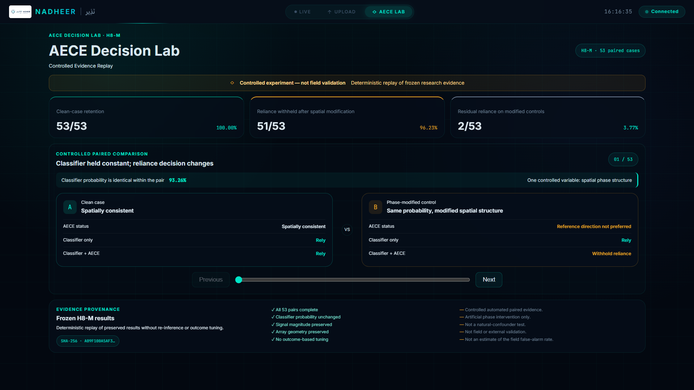
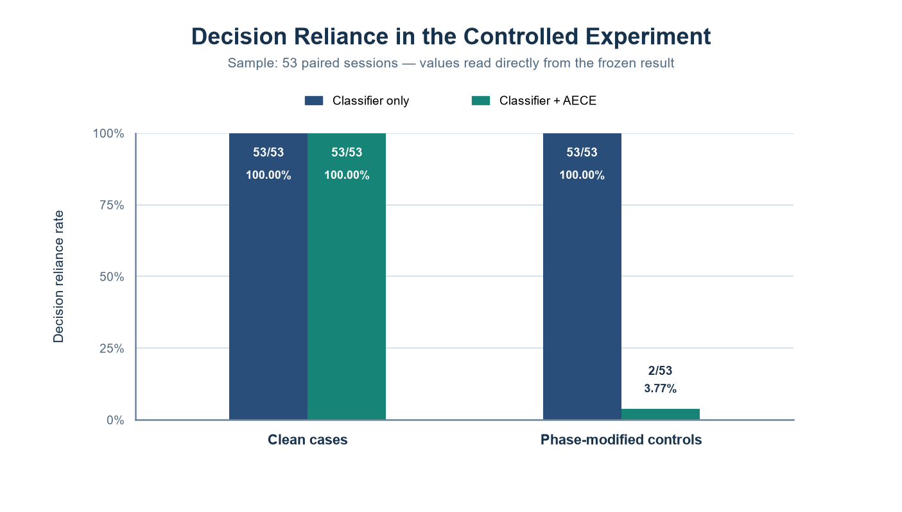
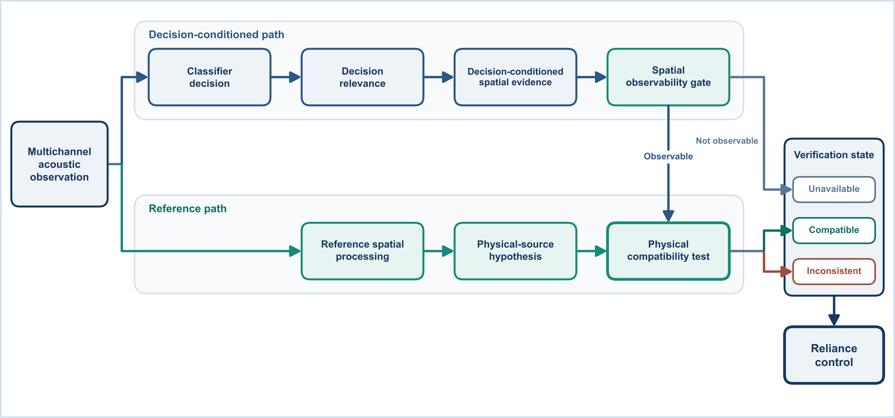

# AECE Controlled Experimental Evidence

AECE is implemented in NADHEER as a decision-level physical-consistency evaluation. At a public functional level, it checks whether decision-relevant spatial evidence is observable and compatible with a physical-source hypothesis before controlling reliance on the original acoustic classification decision.

The Decision Lab is a deterministic replay of the frozen H8-M evidence. It does not re-run inference or tune outcomes and is not a new experiment. The truncated fingerprint visible in the image identifies the archived copy of the result file with Windows (CRLF) line endings; after line-ending normalization it matches the frozen result identity reported below (547BD9E1…05DF).

## H8-M result

H8-M is a **controlled paired mechanistic experiment** over 53 paired sessions (106 evaluated cases). Both policies retained reliance on all clean cases (53/53). For phase-modified controls with the classifier score held unchanged, classifier-only reliance was 53/53 and classifier-plus-AECE reliance was 2/53. AECE withheld reliance in 51/53 controls (96.23%; Wilson 95% interval 87.25%-98.96%).

The exact two-sided paired secondary analysis value was `8.881784197001252e-16`. The frozen result identity is `547BD9E1E0DF965715E951234DC2A9FFDA422FF2163BA90ACD1F1CD154F005DF`.

Machine-readable public values are in the [sanitized H8-M summary](h8m_public_summary.json).

## Follow-up analyses (post-hoc)

- **H8-N:** a decision-agnostic coherence check also achieved 53/53 clean retention and 53/53 withholding on the H8-M phase-modified controls, so H8-M alone does not distinguish AECE from a generic coherence check.
- **H8-O:** when phase was randomized only in decision-supporting regions, AECE withheld reliance in 51/53 sessions; when an equal number of other regions was modified, it withheld in 0/53. The coherence check withheld in 30/53 and 34/53 sessions respectively. The 0/53 result follows from AECE's design.
- **H8-P:** median processing time 2.59 s (p95 2.94 s) per one-second window on an Intel Core i7-10750H CPU; unoptimised and not real-time.

Values and frozen result identities are in the [follow-up summary](h8_followup_public_summary.json).

## Mandatory limitations

- H8-M used a phase-only artificial intervention that changed phase structure while preserving the controlled classifier score.
- This was not natural-confuser testing.
- This was **not field or external validation**.
- The 96.23% result is **not a real-world false-alarm estimate**.
- All 53 sessions of an outcome-blind, hash-based held-out split were included without exclusion; retention applies to classifier-gate-pass sessions from one dataset, not general sensitivity.
- H8-N and H8-O are post-hoc; in H8-L and H8-O the reference hypothesis was held at its clean value, so the reference path was not tested on modified recordings.
- H8-M did not exercise the Unavailable state; all 53 phase-modified controls resolved to a decisive state, so observability-aware unavailability is untested in this experiment.

## Conceptual position

The diagram intentionally omits rules, thresholds, equations, calibration methods, and implementation code.

The [platform demonstration](../../media/videos/nadheer_platform_demo.mp4) includes a Decision Lab segment showing deterministic replay of the aggregate H8-M evidence. It is interface evidence, not a new experiment or field validation.
