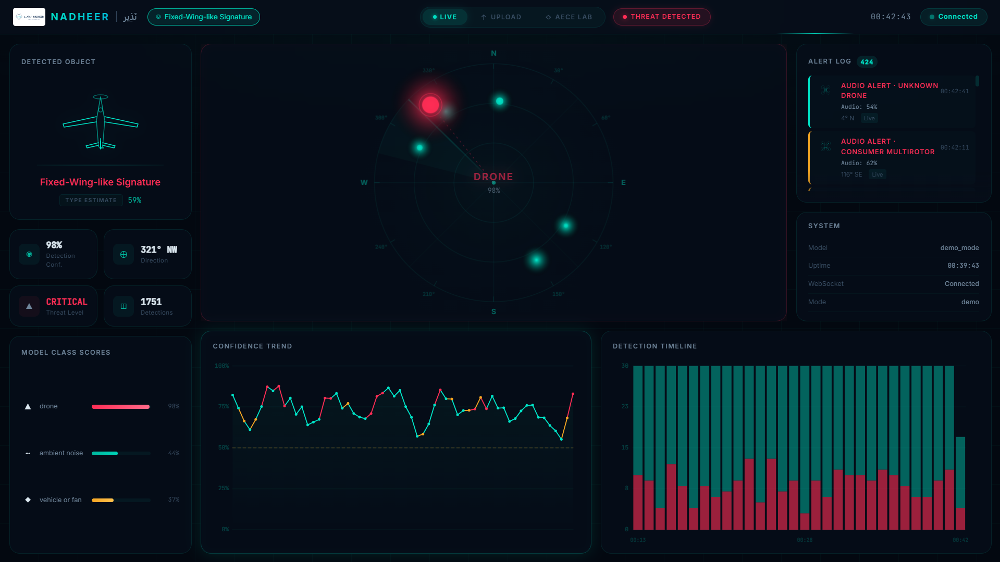

# Implemented Platform Evidence

NADHEER is an implemented edge-oriented research platform that integrates acoustic classification, direction estimation when multichannel input is available, visual detection, tracking, decision fusion, evidence logging, and a browser dashboard.

## What this establishes

- A functioning NADHEER dashboard and implemented system interface exist.
- Audio-event, directional, status, and alert information can be displayed by the platform.

## What this does not establish

- The displayed screenshot visibly reports `demo mode`; it is interface implementation evidence, not a live field experiment.
- The screenshot does not establish detection accuracy, field false-alarm rate, operational range, or external validation.
